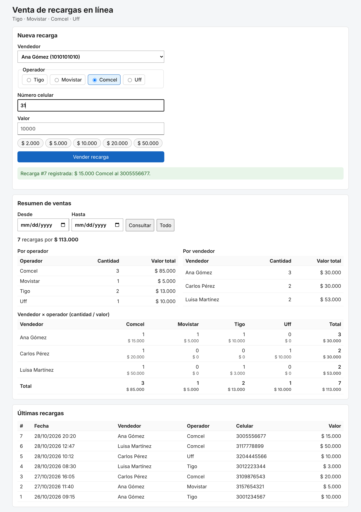

# Recargas en línea

Aplicación web para vender recargas de celular (Tigo, Movistar, Comcel, Uff) y consultar en cualquier momento la **cantidad y el valor de las recargas discriminados por operador y por la persona que realiza la venta**.

| Capa | Tecnología |
|---|---|
| Backend | Java 17, Spring Boot 3.5 (Web, Data JPA, Validation) |
| Base de datos | H2 en memoria (por defecto) o PostgreSQL (perfil `postgres`) |
| Frontend | Angular 22 (componentes standalone, signals, reactive forms) |
| Diagramas | PlantUML (`docs/diagramas`) |

```
recargas-online/
├── backend/            API REST Spring Boot
├── frontend/           Pantalla Angular de venta y resumen
├── db/postgres/        Script del modelo relacional para PostgreSQL
└── docs/
    ├── diagramas/      Relacional, casos de uso, secuencia y clases (.puml + .png)
    └── pantalla-venta-recargas.png
```

## Cómo ejecutarlo

Requisitos: JDK 17+, Maven 3.9+, Node 22.22+ (o 24+).

**1. Backend** (puerto 8080, con H2 y datos de ejemplo):

```bash
cd backend
mvn spring-boot:run
```

Consola H2: http://localhost:8080/h2-console (JDBC URL `jdbc:h2:mem:recargas`, usuario `sa`).

**2. Frontend** (puerto 4200, redirige `/api` al backend mediante `proxy.conf.json`):

```bash
cd frontend
npm install
npm start
```

Abrir http://localhost:4200

**Pruebas**

```bash
cd backend && mvn test        # pruebas de integración de la API (MockMvc + H2)
cd frontend && npm test       # pruebas del componente (Vitest)
```

### Con PostgreSQL

```bash
createdb recargas
psql -d recargas -f db/postgres/schema.sql
cd backend
DB_URL=jdbc:postgresql://localhost:5432/recargas DB_USER=postgres DB_PASSWORD=... \
  mvn spring-boot:run -Dspring-boot.run.profiles=postgres
```

## API

| Método | Ruta | Descripción |
|---|---|---|
| GET | `/api/operadores` | Operadores activos |
| GET | `/api/vendedores` | Vendedores activos |
| POST | `/api/recargas` | Vende una recarga → `201 Created` |
| GET | `/api/recargas?limite=20` | Últimas recargas vendidas |
| GET | `/api/recargas/resumen?desde=AAAA-MM-DD&hasta=AAAA-MM-DD` | Cantidad y valor por operador, por vendedor y por operador × vendedor (fechas opcionales) |

Ejemplo de venta:

```json
POST /api/recargas
{ "operadorId": 1, "vendedorId": 1, "numeroCelular": "3001234567", "valor": 10000 }
```

Reglas: el celular debe tener 10 dígitos y empezar por 3; el valor va de $1.000 a $500.000; operador y vendedor deben existir y estar activos.
Los errores se responden en formato RFC 7807 (`application/problem+json`): `400` datos inválidos (con el detalle por campo en `errores`), `404` operador o vendedor inexistente, `422` regla de negocio.

En `backend/api.http` están todas las peticiones listas para ejecutar desde IntelliJ o VS Code (REST Client).

## Diseño

- **Capas**: `web` (controladores REST y manejo de errores) → `service` (reglas de negocio, transacciones) → `repository` (Spring Data JPA) → `domain` (entidades). Los DTO son `record` de Java.
- **Totales en tiempo real**: el resumen se calcula con consultas JPQL agrupadas (`GROUP BY`) sobre la tabla `recarga`, indexada por operador, vendedor y fecha. Operadores y vendedores sin ventas aparecen en cero.
- **Pantalla**: un formulario de venta que conserva vendedor y operador entre ventas, y un panel de resumen que se refresca después de cada venta, con filtro por rango de fechas y una tabla cruzada vendedor × operador.
- **Integración con operadores**: la venta se registra localmente; la llamada real a cada operador se puede agregar en `RecargaService` con una fábrica abstracta por operador (ver diagrama de casos de uso).

## Diagramas

| | |
|---|---|
| Modelo relacional | `docs/diagramas/01-modelo-relacional.png` |
| Casos de uso | `docs/diagramas/02-casos-de-uso.png` |
| Secuencia (vender recarga) | `docs/diagramas/03-secuencia-vender-recarga.png` |
| Clases | `docs/diagramas/04-clases.png` |


